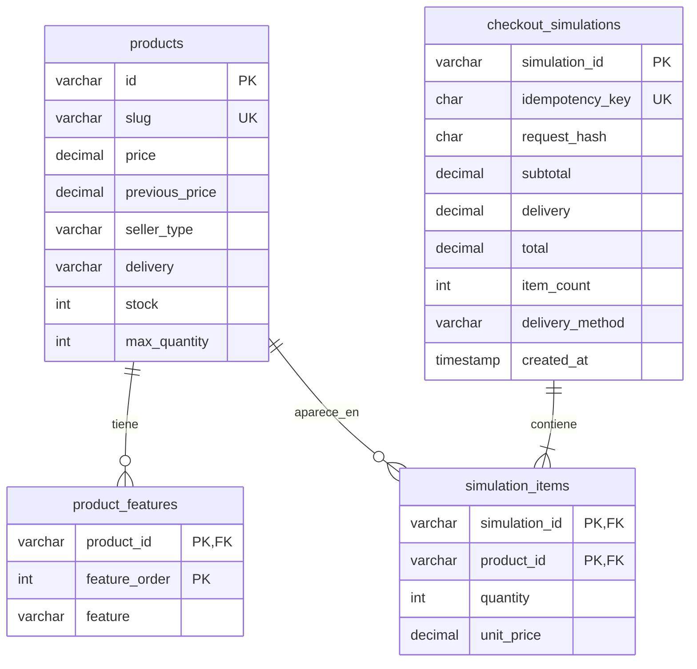

# Modelo de datos MySQL

El backend utiliza una base MySQL dedicada al proyecto. Flyway crea y versiona la estructura; el catálogo se consulta mediante Spring JDBC. No se usa un catálogo alternativo en memoria durante la ejecución normal.

| Tabla | Responsabilidad |
| --- | --- |
| `products` | Identidad, marca, nombre, descripción, importes, valoración ficticia, imagen referencial, vendedor, modalidades, stock y límite |
| `product_features` | Características ordenadas de cada producto |
| `checkout_simulations` | Resultado académico, clave única de reintento, huella de la solicitud e importes definitivos |
| `simulation_items` | Productos, cantidades y precios unitarios registrados al finalizar |

Las claves foráneas conservan las relaciones. Hay índices para precio, marca, calificación y vendedor/modalidad. Los importes se almacenan con `DECIMAL(10,2)` y se calculan con `BigDecimal`; no se usan flotantes para dinero. Los `CHECK` evitan valores negativos y mantienen la relación `total = subtotal + delivery` en la simulación.

## Migraciones

- `V1__create_schema.sql`: tablas, claves, índices y restricciones.
- `V2__seed_demo_products.sql`: seis freidoras y veinticuatro características ficticias de demostración.

Flyway registra las versiones en `flyway_schema_history`. El arranque posterior valida y conserva la estructura; no borra los datos. Después de aplicar una migración en una base compartida, los cambios deben agregarse como una nueva migración, sin editar las versiones ya aplicadas. La operación `clean` de Flyway está deshabilitada.

La base recomendada por `back/compose.yaml` es MySQL 8.4. Se verificaron las migraciones y la persistencia sobre MySQL 8.0.46 real en una instancia temporal aislada. Esto no certifica versiones anteriores ni sustituye comprobar el entorno de despliegue final.

## Límites del modelo

No hay tablas de cuentas, contraseñas, tarjetas, órdenes comerciales, carrito, favoritos ni comparación. El contrato y la guía frontend identifican el estado que debe mantener el cliente.

La dirección y su referencia se validan en la solicitud de domicilio y no se almacenan en texto. Se guarda una huella de la carga normalizada para verificar que un reintento con la misma clave corresponde a los mismos datos; esa huella no se devuelve en la API. La simulación no reduce stock, no reserva productos y no contrata una entrega.

La clave de idempotencia es única en MySQL. El registro y sus líneas se insertan en una transacción. Ante dos solicitudes simultáneas con la misma clave, una inserta y la otra recupera el resultado comprometido; si la huella es distinta, responde 409.

Los datos semilla, incluidas las valoraciones, precios, vendedores y cantidades, son ejemplos académicos. No representan información comercial vigente de los fabricantes o de Falabella.

## Configuración

`DB_URL`, `DB_USERNAME` y `DB_PASSWORD` se proporcionan al backend mediante variables de entorno. El navegador no conoce esas credenciales. El Compose del proyecto usa un volumen propio y publica MySQL solo en `127.0.0.1:3307`, evitando reutilizar el servicio local en 3306.

Las pruebas con MySQL usan variables `IT_DB_*` y exigen un nombre de base terminado en `_test` antes de abrir la conexión. No usar bases con información de otras aplicaciones. La configuración e instrucciones completas están en [back/README.md](../back/README.md).

Referencias técnicas: [migraciones en Spring Boot](https://docs.spring.io/spring-boot/how-to/data-initialization.html), [MySQL y versiones LTS](https://dev.mysql.com/doc/refman/8.4/en/mysql-releases.html).
